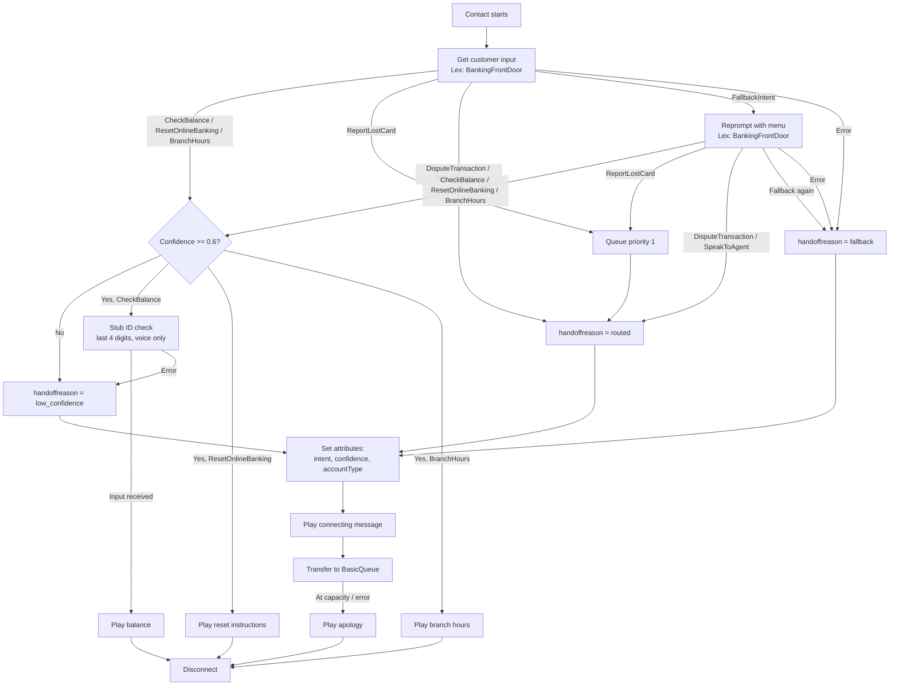
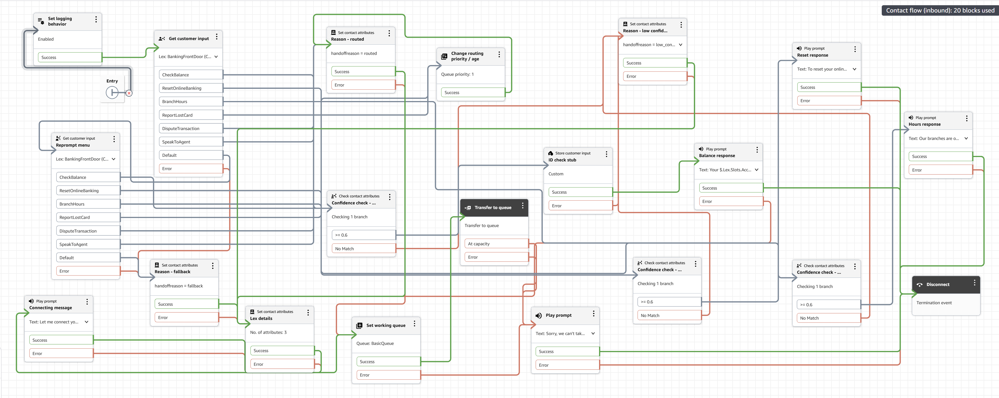
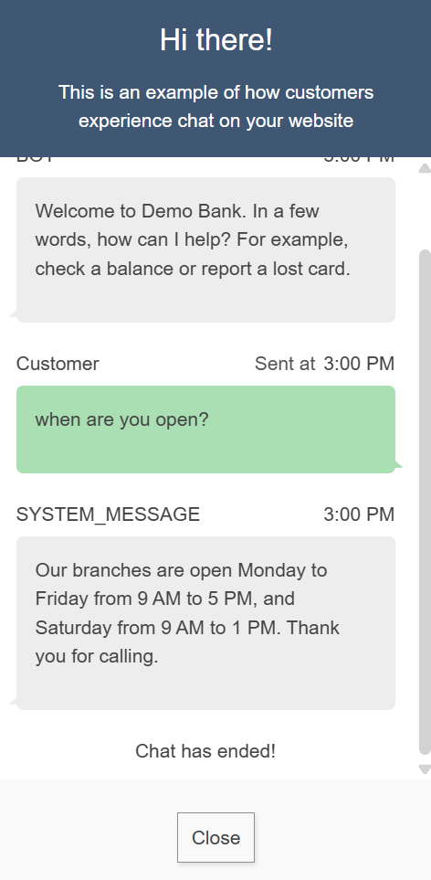
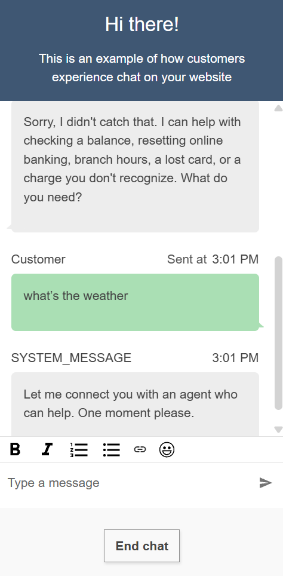
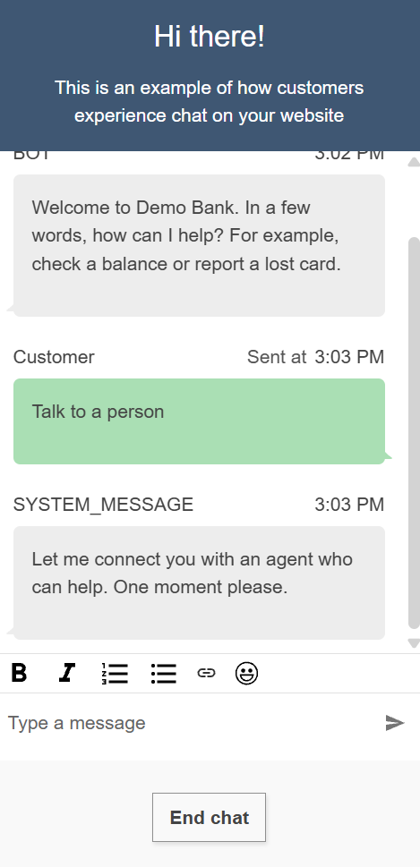
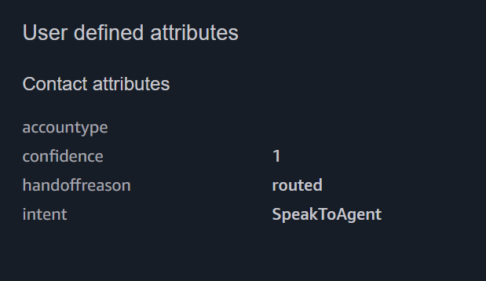

# BankingFrontDoor: Lex V2 + Amazon Connect banking IVR

## Overview

A front-door IVR for a fictional bank ("Demo Bank"). An Amazon Lex V2 bot classifies what the caller wants, and an Amazon Connect contact flow either answers it (self-serve) or routes the contact to an agent with context attached.

- Bot: `BankingFrontDoor`
- Locale: `en_US` (Lex V2 has no `en-CA` locale)
- Region: `ca-central-1`
- Lex intent confidence threshold: 0.40

Repo layout:

```
connect/BankingFrontDoor-IVR.json   Connect contact flow export
lex/BankingFrontDoor-v1/            Lex V2 bot export (LexJson)
docs/findings.md                    Observations from testing intent scores
docs/screenshots/                   Flow canvas and test chat screenshots
```

## Architecture





## Intents

| Intent | Handling | Notes |
|---|---|---|
| CheckBalance | Self-serve | Slot `AccountType`: chequing, savings, credit card, with synonyms |
| ResetOnlineBanking | Self-serve | Points the caller to the app's Forgot password option |
| BranchHours | Self-serve | Plays hours |
| ReportLostCard | Route to agent | Queue priority 1 |
| DisputeTransaction | Route to agent | |
| SpeakToAgent | Route to agent | |
| FallbackIntent | Reprompt, then agent | Built-in Lex intent |

## Design decisions

- **Two thresholds.** Lex returns FallbackIntent when no intent scores above 0.40, and it also applies its own out-of-scope logic: in testing it chose FallbackIntent for "help" even though SpeakToAgent scored 0.73 (see F3). The flow adds a stricter check (>= 0.6) only on the three self-serve intents, since a wrong self-serve answer costs more than an unneeded transfer. Agent-routed intents skip the check because they end at an agent anyway. The 0.6 value is a placeholder until an evaluation is run.
- **Stub ID check before the balance.** The caller gives the last 4 digits of their card before hearing a balance. It is a stub (no real lookup) and applies to voice only.
- **Lost card first.** ReportLostCard sets queue priority 1 so those contacts are answered ahead of others.
- **One reprompt on fallback.** The first fallback plays a short menu of what the bot can do and listens again. A second fallback goes to an agent instead of looping.
- **Context for the agent.** Every agent path sets `handoffreason` (`routed`, `low_confidence`, or `fallback`) plus `intent`, `confidence`, and `accountType` as contact attributes, so the agent and contact search show why the contact arrived. A connecting message plays before the transfer to `BasicQueue`.

## Testing

Tested with the Connect test chat:

| Scenario | What was checked |
|---|---|
| Branch hours | Self-serve answer |
| Password reset | Self-serve answer |
| Fallback reprompt | Menu reprompt after an unrecognized request |
| Agent handoff | Connecting message, then transfer to BasicQueue |
| Handoff attributes | `handoffreason`, `intent`, `confidence`, `accountType` in Contact search |

Not yet tested: the CheckBalance path over voice (including the ID check).

| Branch hours | Fallback reprompt | Connecting to agent |
|---|---|---|
|  |  |  |

Attributes on a contact routed by the SpeakToAgent intent (`handoffreason = routed`):



On a fallback contact, handoffreason = fallback and confidence is empty because FallbackIntent is never scored.

## Findings

Observations from the Lex test console on intent scores, overlap between intents, and how fallback behaves are in [docs/findings.md](docs/findings.md). Main points:

- A high top score can hide a close runner-up, so the margin between the top two scores is worth tracking.
- Lex can choose FallbackIntent even when another intent scores well above the threshold.
- Out-of-scope input still scores 0.5 to 0.76 on some intents, so a score threshold alone does not separate in-scope from out-of-scope.
- Exact training utterances score 1.0 in production, so the evaluation set must use phrasings that are not in the training data.

## How to deploy

These steps have not yet been verified by re-importing from this repo.

1. **Import the Lex bot.** Zip the contents of `lex/BankingFrontDoor-v1/` (so `Manifest.json` is at the root of the zip) and import it in the Lex V2 console in your region. Build the `en_US` locale, create a version, and create an alias.
2. **Attach the bot to Connect.** In the Connect instance settings, add the Lex bot alias under Flows > Amazon Lex.
3. **Replace the placeholders** in `connect/BankingFrontDoor-IVR.json`:

   | Placeholder | Replace with |
   |---|---|
   | `<LEX_BOT_ALIAS_ARN>` | `arn:aws:lex:<region>:<ACCOUNT_ID>:bot-alias/<LEX_BOT_ID>/<LEX_ALIAS_ID>` |
   | `<CONNECT_QUEUE_ARN>` | `arn:aws:connect:<region>:<ACCOUNT_ID>:instance/<CONNECT_INSTANCE_ID>/queue/<QUEUE_ID>` for BasicQueue |

   `lex/.../Bot.json` contains `<LEX_BOT_ID>` as its identifier. Lex assigns a new ID on import, so this value does not need to match.
4. **Import the flow.** In Connect, create a new contact flow, choose Import, select the edited JSON, then save and publish. Check that the Lex blocks and the queue block show the right bot and queue.
5. Assign the flow to a phone number or use the test chat to try it.

## Limitations and next steps

- Run an evaluation at flow thresholds 0.5, 0.6, and 0.7 with a test set that includes ambiguous and out-of-scope phrases, then pick the self-serve threshold.
- Test the CheckBalance path over voice, including the ID check.
- The ID check and balance are stubs. There is no backend lookup.
- Add a French locale (`fr_CA`).
- All agent routes use `BasicQueue`. Production would use separate queues per intent.

## How this was built

I built the Lex and Connect configuration by hand in the AWS console and used Claude Code to prepare the repo, scrub identifiers, and draft documentation.
